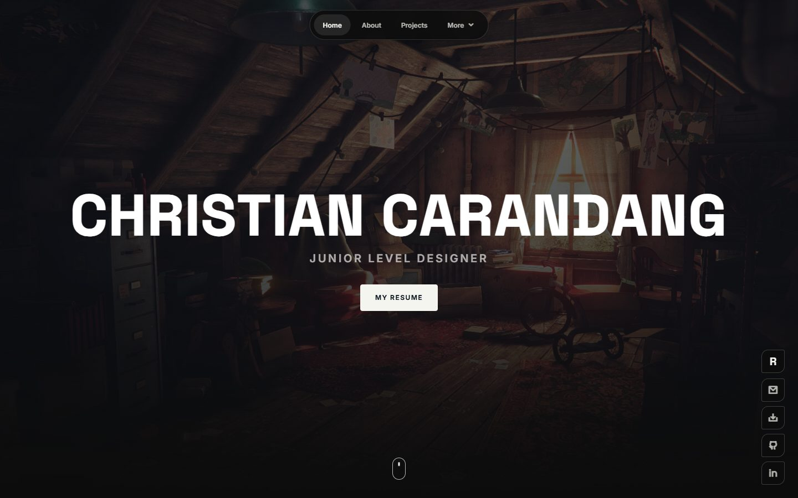
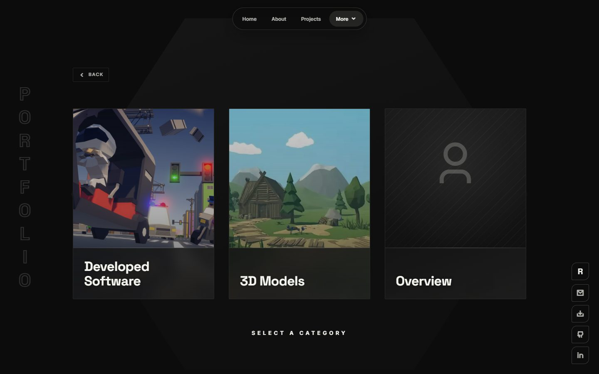
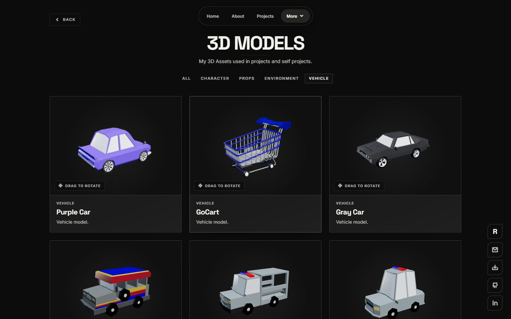
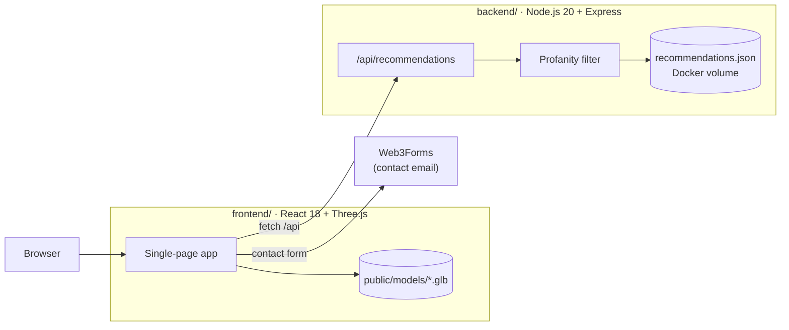

<div align="center">

# Christian Carandang — Portfolio

**Full-stack personal portfolio: React front end with interactive 3D model viewers, a Node.js recommendations API, and Docker-based dev/prod environments.**

[](https://portfolio-carandang.vercel.app)

[](https://github.com/cntaxc/portfolio-carandang/actions/workflows/ci.yml)
[](https://portfolio-carandang.vercel.app)


</div>

<p align="center">
  
</p>

<table>
  <tr>
    <td width="50%"></td>
    <td width="50%"></td>
  </tr>
  <tr>
    <td align="center"><sub>Portfolio hub</sub></td>
    <td align="center"><sub>Interactive 3D model showcase</sub></td>
  </tr>
</table>

## Highlights

- **Interactive 3D showcase**: 26 game assets rendered with Three.js. Drag to rotate (zoom disabled), category filters, a paginated 3×3 grid, and lazy loading so each model downloads only when its card scrolls into view. Cards are generated automatically from the `.glb` files in the models folder.
- **Portfolio hub**: category cards with hover animations, a cross-fading project slideshow and a typewriter caption.
- **Recommendations**: visitors submit recommendations that publish instantly, are screened by a profanity filter (English, Tagalog/Filipino and Spanish, including leetspeak and spacing tricks) and can be moderated from the command line.
- **Contact form** that posts straight to Web3Forms from the browser.
- **Design system**: a single "Cozy Black" theme with shared typography and colour tokens, responsive from phone to desktop, and reduced-motion support.
- **Production setup**: multi-stage Docker images, Nginx with gzip and security headers, health checks, and CI on every push.

## Architecture



| Part | Stack | Notes |
|------|-------|-------|
| [`frontend/`](frontend) | React 18 (Create React App), Three.js | Served by the dev server in development and by Nginx in production |
| [`backend/`](backend) | Node.js 20, Express | Small JSON-file store, rate limiting, tested with `node:test` |
| [`docker-compose.yml`](docker-compose.yml) | Docker Compose | Dev stack with hot reload |
| [`docker-compose.prod.yml`](docker-compose.prod.yml) | Docker Compose | Production stack: Nginx on `:8080`, API internal only |

## Getting started

**Requirements:** Docker Desktop. Node.js 20 is optional, for running things outside Docker.

```powershell
git clone https://github.com/cntaxc/portfolio-carandang.git
cd portfolio-carandang
copy frontend\.env.example frontend\.env.local   # then add your Web3Forms key

docker compose up -d --build                     # or: .\scripts\start-dev.ps1
```

| Service | URL |
|---------|-----|
| Frontend (hot reload) | http://localhost:3000 |
| Backend API | http://localhost:8000/health |

Production build locally:

```powershell
docker compose -f docker-compose.prod.yml up -d --build   # or: .\scripts\start-prod.ps1
# http://localhost:8080
```

Development and production use separate Compose project names, so both can run at once.

<details>
<summary><b>Running without Docker</b></summary>

```powershell
npm --prefix backend install
npm --prefix backend run dev        # API on :8000

npm --prefix frontend install
npm --prefix frontend start         # app on :3000, /api proxied to :8000
```
</details>

## Project structure

```
.
├── frontend/          React app: components, data, styles, 3D models (see frontend/README.md)
├── backend/           Recommendations API, profanity filter, tests (see backend/README.md)
├── docs/screenshots/  Images used in this README
├── scripts/           start-dev.ps1 / start-prod.ps1 convenience launchers
├── .github/workflows/ CI: backend tests + frontend production build
├── docker-compose.yml
└── docker-compose.prod.yml
```

## Testing

```powershell
npm --prefix backend test           # store, moderation, profanity filter
npm --prefix frontend run test:api  # Vercel recommendations function (fake Supabase)
npm --prefix frontend run build     # production build (CI treats lint warnings as errors)
```

Both run automatically on every push through [GitHub Actions](.github/workflows/ci.yml).

## Deployment

**Frontend: Vercel.** The project's *Root Directory* is set to `frontend`. Vercel runs `npm run build` and serves `build/`. Set `REACT_APP_WEB3FORMS_ACCESS_KEY` as a *Config* environment variable. It's embedded in the public bundle by design, since Web3Forms keys are public identifiers.

**Recommendations API on Vercel: serverless function + Supabase.** On Vercel, `/api/recommendations` is served by [`frontend/api/recommendations.js`](frontend/api/recommendations.js), which stores data in a Supabase (Postgres) table. It applies the same validation, profanity filter and rate limit as the Express backend.

1. Create a free project at [supabase.com](https://supabase.com), then run [`docs/supabase-setup.sql`](docs/supabase-setup.sql) in its SQL Editor. This creates the table and locks it down with Row Level Security.
2. In Vercel, under Settings → Environment Variables, add these as **Secret** for Production:
   - `SUPABASE_URL`: Supabase → Project Settings → API → Project URL
   - `SUPABASE_SECRET_KEY`: Supabase → Project Settings → API Keys → a **secret** key (`sb_secret_…`, or the legacy `service_role` key)
3. Redeploy.

Only the server function holds the secret key; browsers only ever call `/api/recommendations`. Locally, Docker Compose keeps using the Express backend in `backend/`.

## Moderating recommendations

**Live site (Supabase):** open Supabase → Table Editor → `recommendations`, select the row and delete it. The site shows the change on the next refresh.

**Local Docker:** recommendations are stored in `/app/data/recommendations.json` inside the backend container (Docker volume `docker-react-portfolio_recommendation-data-dev`).

```powershell
docker compose exec backend npm run recommendations -- list           # show entries and ids
docker compose exec backend npm run recommendations -- delete <id>    # remove one
docker compose exec backend npm run recommendations -- clear --yes    # remove all
```

The running API picks up the change immediately. Hand edits to the JSON file work too. See [backend/README.md](backend/README.md) for details.

## Contact

**Christian Raphael A. Carandang**, Laguna, Philippines
[GitHub](https://github.com/cntaxc) · [LinkedIn](https://www.linkedin.com/in/christian-carandang-b30015334/) · [Live portfolio](https://portfolio-carandang.vercel.app)
